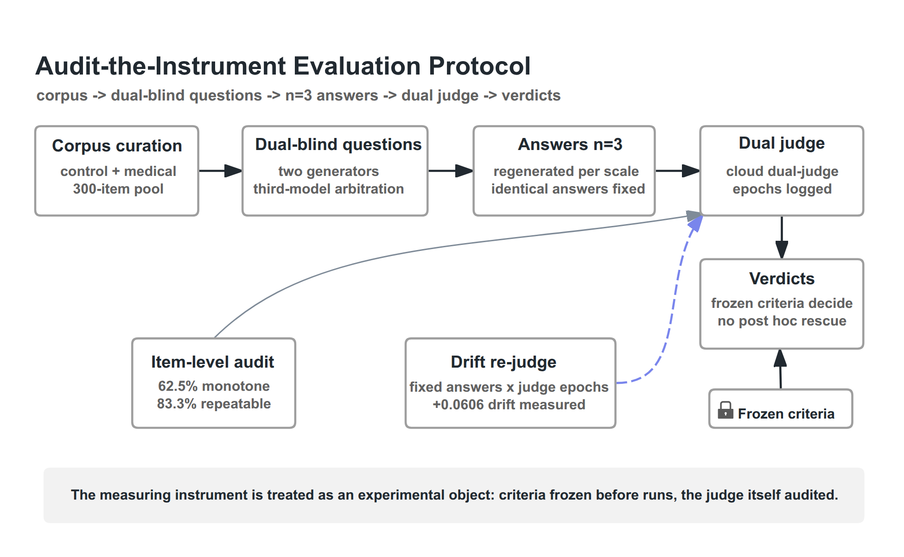
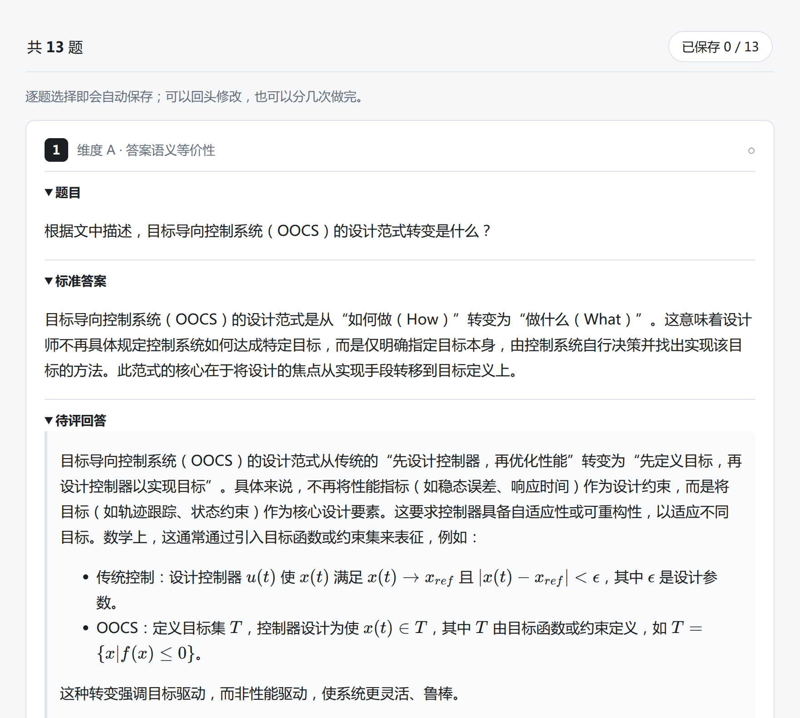

# Sci-Align Benchmark

[](https://github.com/MorningStar0709/sci-align-benchmark/actions/workflows/ci.yml)

**An evaluation protocol that audits its own measuring instrument, and the evidence that doing so
changes the answer.** 1,979 control-science questions, dual-blind judging with third-model
arbitration, promotion criteria frozen before any scored comparison — implemented end to end by
one person, under constrained compute.

[中文说明 · Chinese](README.zh-CN.md) · [The protocol](PROTOCOL.md) · [What can be recomputed here](ARTIFACT.md) · Apache-2.0 code / CC-BY-4.0 data



*The measuring instrument is treated as an experimental object: criteria frozen before runs, the
judge itself audited.*

---

## Why this exists

LLM-as-a-judge is now the default way to score post-training gains on tasks with no reference
answer. The instrument itself is almost never audited in the studies it serves: scores drift when
the scoring service changes between evaluation epochs, and a single generation is one draw from an
unmeasured distribution. This project makes evaluation the object of study rather than an assumed
tool. Two preprints state it:

| | Paper | Preprint |
|:--|:--|:--|
| **B** | *Benchmarking Post-Training Under Constrained Compute: Protocols for Question Generation, Variance-Controlled Evaluation, and Judge Auditing* | [10.5281/zenodo.23409480](https://doi.org/10.5281/zenodo.23409480) |
| **A** | *What Determines the Direction of Post-Training Gains? A Preregistered Multi-Scale Study of Method, Scale, and Base-Model Identity* | [10.5281/zenodo.23409394](https://doi.org/10.5281/zenodo.23409394) |

B states the protocol; A is that protocol applied. This repository is where both were implemented
and where their numbers can be checked.

## What is here

| The pool | The protocol | The evidence |
|:--|:--|:--|
| 1,979 control-science questions from 361 sources, every item carrying a machine-readable licence bucket | dual-blind judging with third-model arbitration · promotion criteria frozen in writing before any scored comparison · n=3 regeneration to calibrate between-generation variance · drift detected by re-judging fixed answers across judge epochs | 237 per-item evaluation files (~32,000 judged answers); every aggregate printed inside them is re-derivable from their per-item records |



*The human-rater harness in `humaneval/` — the one the automated judge was checked against. A rater sees
the question, the reference answer and the answer being rated, scores one dimension at a time, and can
stop and resume; thirteen items take about 35–55 minutes. The interface is Chinese, as administered.*

## By the numbers

| | | How to check it |
|:--|--:|:--|
| Question pool | 1,979 items, 361 sources | [`SOURCES.md`](SOURCES.md), or recipe 1 below |
| Answers judged, as per-item records | ≈32,000 | recipe 4 below |
| Per-item evaluation files | 237 | [`release/public-eval-files.txt`](release/public-eval-files.txt) |
| Model identities evaluated | 81 — 23 of them reachable here | **no** — the evidence is in the development repo |
| Compute | ≈350–400 GPU-hours | **no** — the evidence is in the development repo |
| Unattended pipeline wall-clock | 194 h, 12 logged segments | the value ships (`provenance/unattended_walltime.json`); re-deriving it fails closed (ARTIFACT row 4) |
| Code | ≈100k lines; this checkout carries the evaluation and verification subset | **no** — the evidence is in the development repo |
| Effort | 4 months · one author · a laptop and one rented A800 | — |

The study as a whole judged **≈71,000 answers across 545 products**; the 399 products not shipped here are
exactly the ones no figure in either paper reads. Where a row says **no**, the per-task evidence sits in the
development repository, which is not public — we would rather say that than imply otherwise.
[`ARTIFACT.md`](ARTIFACT.md) says, item by item, what this checkout can and cannot recompute.

## What was trained, and what it was measured on

The post-training matrix is frozen in a single registry that ships here:
[`release/adapter_manifest.json`](release/adapter_manifest.json). It records **25 arms** — two domains (control,
medical) × three model sizes (4B, 9B, Gemma) — of which **6 are base/raw baselines and 19 are trained LoRA
adapters**, each entry carrying its base model, the adapter's `sha256`, and the eval run paths it feeds. The same
file carries 11 surface adapters, the judge prompts used, and the evaluation freeze (its flags and a note).

Training ran on one RTX 5090; the judge-heavy evaluation also ran on rented A800 time (see *By the numbers*
above, and [`ARTIFACT.md`](ARTIFACT.md) row 13).

The training and orchestration **scripts** are not distributed — they carry the batch codenames of the specific
experiments and assume local model weights and log directories. What ships instead is the registry above, the
aggregation and verification code that produced the published numbers, and the per-item outputs themselves. The
adapters are not published either: see [`adapters/`](adapters/README.md).

## Selected findings

**The winning method depends on the scale you run it at.** Two reinforcement-style methods reverse
their ordering between 4B and 9B. At 4B, RLVR-C v2 leads MGPO-EG, though both sit *below* their SFT
baseline (relative gains of −0.9% and −5.1%); at 9B, MGPO-EG overtakes it, again relative to SFT
(+7.6% against +2.0%). Two independent generalisation probes — a second base family and a second
task domain — both flip the *sign* of the gain the same way, tracking base-model identity rather
than the method.

**The judge moved, and the protocol caught it.** Re-judging identical answers on a later scoring
epoch shows a systematic upward shift in the control domain (the published aggregate is +0.0606 on
the judged score, with all 11 model arms moving up; the paired per-arm difference re-derived here
lands at ≈+0.06) and essentially none in the medical domain. Because the promotion criteria were
frozen before any scored comparison, that drift moved only one of four preregistered comparisons
across the line.

The full analyses, ablations and stated limitations are in the two preprints. Where a number can be
re-derived from this tree, [`ARTIFACT.md`](ARTIFACT.md) says how — the gain surface quoted above is
row 12, and the command is printed there. Where it cannot, the ledger says that instead: the drift
aggregate is one of the 26 claim anchors, and row 1 of the ledger fails closed on it.

## Engineering discipline, item by item

Each of these ships here, and each is checkable rather than asserted.

- **One command re-derives the headline aggregates.** [`tools/verify_pack.py`](tools/verify_pack.py) is
  stdlib-only: it recomputes each run's `overall_score` from that run's own per-item records, checks the
  file's `sha256` against the projection it feeds, and prints a CHECK table. Nothing in it needs the cloud.
- **Every pool item carries written audit reasoning**, not just a question and an answer: four evidence
  fields per item, ≈2.8 M characters in total, about 60% of them quoting the source passage the judgement
  rests on. Verbatim spans of 300 characters or more are replaced by a placeholder; the rule and its counts
  are in [`LICENSE-LEDGER.md`](LICENSE-LEDGER.md).
- **The rater harness is built so it cannot leak.** In [`humaneval/`](humaneval/README.md): rater codes are
  mounted at run time and never baked into the image; `--no-access-log`, because the URL itself carries the
  token; the process runs as uid 10001 on a read-only root filesystem with all capabilities dropped; and the
  app refuses to serve a pool whose identity does not match its database unless told to explicitly, with the
  mismatch recorded.
- **Checks judge *new* failure, not "all green".** [`scripts/run_provenance_gates.py`](scripts/run_provenance_gates.py)
  runs the checks a public checkout can support and reports only failures that are **new** against a recorded
  baseline. A script that follows the naming convention but appears in neither list is itself a failure.
- **Entry points stop and say why.** Three of the four shipped `--check` commands exit non-zero with a stated
  reason rather than a stack trace, the fourth returns a skip, and
  [`tests/test_entry_smoke.py`](tests/test_entry_smoke.py) invokes all four the way a reader would — so a green
  suite over entry points nobody ran is not possible.
- **Every reading is classified, not asserted.** [`ARTIFACT.md`](ARTIFACT.md) marks each one *Recomputable*,
  *Registered only* or *Fails closed*, including the rows this repository cannot verify.
- **The build is a rule, not a hand-pick.** This checkout is generated from the development repository by one
  script, and [`BUILD-CRITERIA.md`](BUILD-CRITERIA.md) records the admission rule with the resulting file set.

## Quick start

```bash
uv sync --all-packages --all-extras
.venv/bin/python scripts/run_provenance_gates.py   # the gate discipline
.venv/bin/python -m pytest tests/ -q               # 67 passed, 4 skipped
```

Then read the pool ([`benchmark/dataset/core_v3.json`](benchmark/dataset/core_v3.json)), the
protocol ([`PROTOCOL.md`](PROTOCOL.md)), and the claim-by-claim ledger
([`ARTIFACT.md`](ARTIFACT.md)).

### Check the numbers yourself

Each of these runs after a clone; the expected output is beside it.

```bash
# 1. the pool and its per-item licence buckets
#    → 1979 {'redistributable': 685, 'arxiv-only': 927, 'restricted': 241, 'textbook-unchecked': 126}
.venv/bin/python -c "import json;d=json.load(open('benchmark/dataset/core_v3.json'));print(len(d['questions']),d['meta']['license_tagging']['counts_by_bucket'])"

# 2. the eighteen gain cells quoted above → 4B +14.9/−0.9/−5.1, 9B +13.0/+2.0/+7.6
.venv/bin/python -c "import sys;sys.path.insert(0,'papers/paper-a/figures/scripts');import surface_stats as s;[print(k,{a:round(b,1) for a,b in v.items() if a!='gens'}) for k,v in s.gains().items()]"

# 3. one shipped aggregate against the record it was derived from → True
.venv/bin/python -c "import json,hashlib,pathlib;d=json.load(open('release/evidence/medical_mgpo_9b_run1__medical_dual_rejudge.json'));print(hashlib.sha256(pathlib.Path(d['source']).read_bytes()).hexdigest()==d['source_sha256'])"

# 4. the per-item evaluation files and the answers inside them
#    → per-item files: 146 of 237 | answers: 31796
.venv/bin/python -c "
import json
rels=[l.strip() for l in open('release/public-eval-files.txt') if l.strip() and not l.startswith('#')]
docs=[json.load(open(r)) for r in rels]
docs=[d for d in docs if d.get('records')]
print('per-item files:', len(docs), 'of', len(rels), '| answers:', sum(len(d['records']) for d in docs))"
```

The rows that cannot be checked this way, and why, are in [`ARTIFACT.md`](ARTIFACT.md).

## Repository map

```text
benchmark/dataset/     The 1,979-item pool, its licence buckets and its JSON schema
benchmark/eval/        Per-item evaluation products for the headline experiments
provenance/            Registered aggregates: model identities, wall-clock, claim anchors, index
release/evidence/      Per-experiment aggregate JSON the claim ledger points at
packages/, scripts/    The evaluation and verification subset of the toolchain
humaneval/             The human-rater harness used to sanity-check the judge
figures/               Protocol figure and the rater-harness screenshot
```

## What is not here

- **Manuscript sources.** Both papers are published as preprints (DOIs above) and are not duplicated
  here. The only thing under `papers/` is the statistics module behind the gain surface (ledger
  row 12); no manuscript text ships.
- **Training corpora and base-model weights.** Neither is ours to redistribute.
- **Judge API transcripts.** The cloud calls behind the scored answers are not distributed; the
  per-item scores they produced are.
- **Long verbatim source excerpts.** The pool's questions and reference answers are ours; where an audit note
  quotes a source, spans of 300 characters or more are replaced by a placeholder, and every item carries its
  licence bucket (see [`LICENSE-LEDGER.md`](LICENSE-LEDGER.md)). Shorter quotations stay, as citations.
- **LoRA adapters and a dataset mirror.** Not published yet; see [`adapters/`](adapters/README.md).

## Licenses

Code is **Apache-2.0**; data and content are **CC-BY-4.0**. Third-party sources keep their own
terms. [`LICENSE.md`](LICENSE.md), [`LICENSE-LEDGER.md`](LICENSE-LEDGER.md) and
[`SOURCES.md`](SOURCES.md) record what is redistributable, what is not, and how each source is
tracked — including a takedown path for rights holders.

## Lineage

This artifact is the academic continuation of the Sci-Align evaluation track of
[ControlMind](https://github.com/MorningStar0709/ControlMind) — a three-track system (benchmark · data agent ·
medical RAG) that took third prize in the 2026 CICC Data Intelligence Competition (MinerU & Shanghai AI
Laboratory). Relative to that track the pool grew from 500 to 1,979 items and the judge went from single to
dual, so results here are **not directly comparable** with its leaderboard.

## Citation

Metadata — authors included — is in [`CITATION.cff`](CITATION.cff), which GitHub renders as
"Cite this repository".
